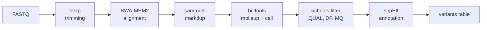

# E. coli variant calling pipeline

🇬🇧 English | [🇷🇺 Русский](README.ru.md) [](https://github.com/Porolo-V/ecoli-variant-pipeline/actions/workflows/ci.yml)

Reproducible short-read variant calling workflow: raw Illumina reads → filtered, annotated variants.
Built on *E. coli* B REL606 (haploid, 4.6 Mb) as a first, deliberately simple case.

## Workflow



Two implementations of the same workflow:
- `scripts/run_all.sh`: plain bash version (also runs FastQC/MultiQC and downloads the data).
- `main.nf` + `nextflow.config`: Nextflow version (6 processes) with a `test` profile.

## Quick start

```bash
mamba env create -f environment.yml
conda activate varcall

# fast test on a 300 kb subset (a few minutes)
nextflow run main.nf -profile test

# full run (downloads data, runs all steps)
bash scripts/run_all.sh
```

## Data

- Reads: SRR2584863 (paired-end Illumina, E. coli evolution experiment), downloaded from ENA.
- Reference: NC_012967.1 (E. coli B str. REL606), FASTA + GenBank from NCBI.

## Results (full sample, bash version)

| Step | Result |
|---|---|
| Reads before / after fastp | 3.10 M / 2.57 M (82.8% kept; Q30 bases 94.4%) |
| Loss reason | 17.2% reads too short after tail trimming, 0.04% low quality |
| Alignment | 100% mapped, 98.2% properly paired |
| Duplicates removed | ~1% |
| Mean depth / breadth | 73x / 99.85% of the genome |
| Variants | 30 raw → 26 (QUAL>30, DP>10) → **22** (MQ>40) |

Of the 22 variants: 13 missense, 3 frameshift, 1 in-frame insertion, 5 up/downstream.
Full table: [`docs/variants_table.tsv`](docs/variants_table.tsv).

<!-- TODO: add docs/multiqc_quality.png and docs/fastp_before_after.png -->

## Filtering decisions

Four variants (positions 263235, 377000, 2407766, 2618472) passed the QUAL/DP filters but had
MQ 22-30, 23-39% of reads with MQ=0 and a mixed ref/alt read split (DP4), which is
unexpected in a haploid organism. This points to repeated regions where reads from several
copies pile up, so a mapping-quality filter (MQ>40) removes them.
The test dataset checks this: position 263235 must be present in the raw VCF and absent after filtering.

## Limitations

- One sample, no orthogonal validation (e.g. IGV inspection, Sanger sequencing).
- Thresholds were chosen by inspecting this sample, not benchmarked.
- Position 2103887 (tandem repeat insertion, depth 28) is kept but has low confidence.
- Indels in homopolymers and repeats are less reliable with short reads.
- The variant table takes the first snpEff `ANN` entry, so intergenic variants can appear as `upstream_gene_variant`.
- `--ploidy 1` is hard-coded in the calling step; other organisms need parameters (planned).
- The Nextflow version was tested on the 300 kb subset, including two samples in parallel (not yet on the full sample).
- The base image `mambaorg/micromamba:latest` is not pinned, and dependencies of the tools (e.g. openjdk, python) are not pinned individually; the resolved versions are listed in `docs/image_packages.txt`.
- `bwa-mem2` is installed as package version 2.3, but the binary reports 2.2.1 (also in the original conda environment); the package version is the one recorded here.

## Problems encountered

- Slow connections to GitHub/NCBI/ENA: solved with multi-connection download (`aria2c -x 8`) from ENA.
- FastQC 0.13 uses `--outdir` instead of `-o`.
- The `.gitignore` rule `data/` also ignored `tests/data`; fixed by anchoring it (`/data/`).
- With several samples only one was processed after alignment: single-file channels (reference, index) are consumed by default. Fixed with value channels and verified with a two-sample run.

## Repository layout

```
main.nf, nextflow.config   Nextflow pipeline and parameters
scripts/run_all.sh         bash version of the full workflow
tests/data/                300 kb read subset and reference for the test profile
docs/                      variant table, image package list, figures
environment.yml            conda environment
Dockerfile                 tools image for the Nextflow processes
.github/workflows/ci.yml   CI: build image, run test, check variants
```

## Docker and CI

The tools used by the Nextflow processes (fastp, bwa-mem2, samtools, bcftools, snpEff) are packaged in a Docker image built from `Dockerfile`; the five tools are pinned to the versions used for the results. The full package list is in [`docs/image_packages.txt`](docs/image_packages.txt).

    docker build -t ecoli-varcall:0.2 - < Dockerfile
    nextflow run . -profile test,docker

GitHub Actions (`.github/workflows/ci.yml`) builds the image and runs the test profile on every push. It checks the result, not only that the run finished: the filtered VCF must contain exactly positions 9972 and 281923, and position 263235 must be present in the raw VCF and removed by the MQ filter. The test is self-contained (the reference is stored in `tests/data/ref`).

## Roadmap

Per-tool BioContainers images, ploidy and annotation parameters for other organisms, multi-organism test datasets.
